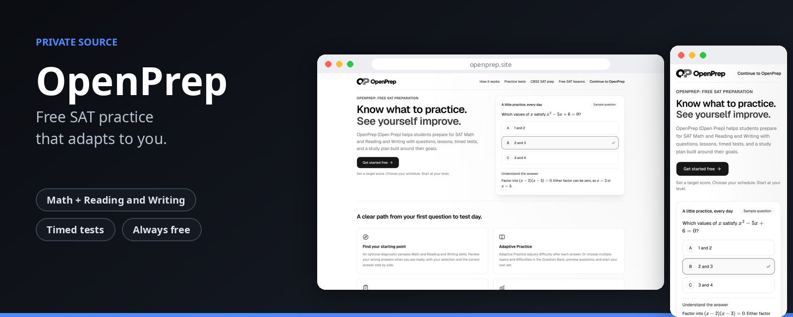

<p align="center"></p>

> Free adaptive SAT practice, with optional Plus and Pro plans.

| | |
|---|---|
| **What it is** | A free SAT practice platform that adapts to each student. |
| **Source** | Private |
| **Public overview** | https://github.com/Shashanksaraswat123939/openprep-overview |

---

Free, open-source adaptive SAT prep. Students can start with the question bank, Smart Practice and tests immediately after onboarding.
An optional diagnostic gives an initial mastery profile; practice answers also personalize the plan. Next.js 16 + Supabase (Postgres + Auth) + Drizzle.

## Run locally

```bash
npm install
cp .env.example .env.local   # fill in (see below)
npm run dev
```

`DEV_USER_ID=<any uuid>` in `.env.local` signs you in as that user **under `next dev` only** (ignored in production
builds), so flows can be exercised without real sign-in.

## Checks

```bash
npx next typegen && npm run typecheck && npm run lint && npm test && npm run content:validate
```

Engine tests are pure; `src/server/*.test.ts` run the real SQL against in-process Postgres (PGlite).

## Database

- Schema: `src/db/schema.ts`; migrations in `drizzle/` (`npm run db:generate` after schema edits).
- Every public table has RLS enabled with **no policies**: the public anon key can read nothing. The app connects
  server-side through the Supabase transaction pooler.
- The app connects as a least-privilege role, `openprep_app` (rows only, no DDL). Create it once per Supabase project
  (SQL editor, as `postgres`), with your own generated password:

  ```sql
  create role openprep_app with login bypassrls password '<generate a long random password>';
  grant usage on schema public to openprep_app;
  grant select, insert, update, delete on all tables in schema public to openprep_app;
  grant usage, select on all sequences in schema public to openprep_app;
  alter default privileges for role postgres in schema public grant select, insert, update, delete on tables to openprep_app;
  alter default privileges for role postgres in schema public grant usage, select on sequences to openprep_app;
  ```

  `DATABASE_URL=postgresql://openprep_app.<project-ref>:<password>@aws-0-<region>.pooler.supabase.com:6543/postgres`
- Migrations need owner rights: set `MIGRATE_DATABASE_URL` (session pooler, port 5432, `postgres` user) and run
  `npm run db:migrate`. The Vercel build runs migrations **only if** `MIGRATE_DATABASE_URL` is set; otherwise it only
  seeds content and builds.
- Account deletion uses `app_private.delete_auth_user(uuid)` (migration `0001`), callable only by `openprep_app` — the
  service-role key is not needed by the app.

## Content

Questions (`content/questions/<skill-id>.json`) and lessons (`content/lessons/<skill-id>.md`) live in git; see
`content/AUTHORING.md`. `npm run content:seed` upserts them (idempotent; removed questions are retired, never deleted).
All content must be original.

## Admins

`/admin` (inbox for feedback, question reports and security reports; users; activity; audit log) is only for
accounts in the `admins` table. The site's database role can read that table but never write it, so admin can only
be granted from the backend. The account must have signed in once. Either:

- Supabase → SQL editor:
  `insert into public.admins (user_id, note) select id, 'owner' from auth.users where email = 'you@gmail.com';`
  (revoke: `delete from public.admins where user_id = (select id from auth.users where email = 'you@gmail.com');`)
- or locally, with `MIGRATE_DATABASE_URL` (the owner connection) in `.env.local`:
  `npm run admin -- grant you@gmail.com "note"`, `npm run admin -- revoke you@gmail.com`, `npm run admin -- list`.

Everyone else gets a 404 on every admin page and action. Every admin change is recorded in `admin_audit`, which the
site can append to but never edit.

## Plans, payments and AI remix

Free students keep the full question bank. Plus and Pro add extra practice tests, AI question remix and more, paid with
one-time PayPal payments (nothing auto-renews). Pricing rules, the PayPal setup, the remix design, and what is not yet
verified are in [docs/PAID_TIERS.md](docs/PAID_TIERS.md). The project overview and history are in
[docs/PROJECT_SUMMARY.md](docs/PROJECT_SUMMARY.md).

## Deploy (Vercel)

Import the repo, region `bom1` (set in `vercel.json`, next to Supabase `ap-south-1`). Environment variables:
`NEXT_PUBLIC_SUPABASE_URL`, `NEXT_PUBLIC_SUPABASE_ANON_KEY`, `DATABASE_URL`, `NEXT_PUBLIC_SITE_URL`, `AI_MODEL`,
`ANTHROPIC_API_KEY` (optional — the tutor shows a friendly message without it), `AI_DAILY_LIMIT`,
`NEXT_PUBLIC_DESMOS_API_KEY` (optional — falls back to a link), `PAYPAL_ENV`, `PAYPAL_CLIENT_ID`, `PAYPAL_CLIENT_SECRET`,
`PAYPAL_WEBHOOK_ID` (payments), and `MISTRAL_API_KEY` with `REMIX_MODEL` (AI remix). Set these in Vercel's environment
settings and redeploy. Then in Supabase → Authentication → URL configuration,
add `https://<your-domain>/auth/callback` to the redirect URLs and set the Site URL.

## Licence

Code AGPL-3.0. Content (questions, lessons) CC BY-NC-SA 4.0. SAT® is a trademark registered by the College Board,
which is not affiliated with, and does not endorse, OpenPrep.
